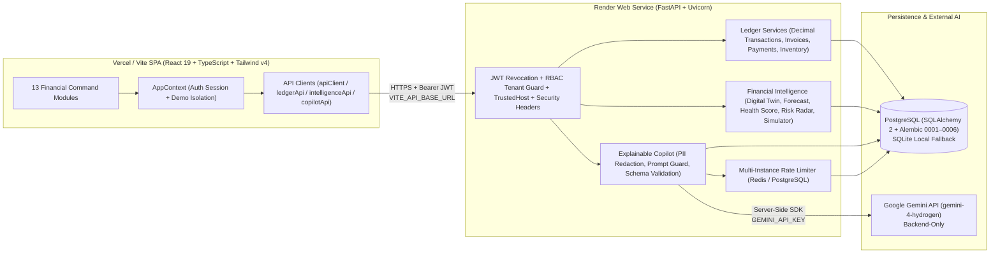

# BizPilot AI

**An AI-Powered Financial Operating System for Small Businesses**

BizPilot AI unifies real-time bookkeeping, receivables, inventory control, multi-tenant role-based security, deterministic `Decimal` financial modeling, a Financial Digital Twin, predictive cash-flow forecasting, risk detection, what-if scenario simulation, and an explainable Google Gemini Decision Copilot into a single command center built for retail shops, grocery stores, restaurants, startups, freelancers, service firms, and growing SMBs.

---

## Architecture Overview



---

## Key Capabilities

### 1. Dual-Mode Operation (Illustrative Demo vs. Live Cloud)
- **Illustrative Demo Mode**: Works immediately with pre-seeded local demo workspaces (`localStorage`-scoped) for frictionless exploration before signing in. Explicitly labeled `Illustrative Demo Data`.
- **Live Cloud Mode**: Authenticates via `/api/v1/auth/login` or `/api/v1/auth/register` (`sessionStorage` JWT), loads PostgreSQL-backed businesses, and routes all CRUD, financial intelligence, simulations, and Gemini Copilot conversations through the FastAPI backend. Demo reset actions strictly target `is_demo_data = true` records and never touch live cloud data.

### 2. Core Frontend Modules (13 Routes)
1. **Overview (`overview`)**: Executive KPIs (Revenue, Expenses, Net Profit, Available Cash), cash-flow trend, category breakdowns, Business Intelligence strip, and Financial Health score.
2. **Financial Digital Twin (`financial-twin`)**: Live Asset/Liability balance sheet model, Quick Ratio, Cash Runway, Fixed vs. Variable Cost Ratio, Collection Efficiency, obligations timeline, and change drivers.
3. **Transactions Ledger (`transactions`)**: Full income/expense ledger with category creation, search/filtering, backend CSV export, and audit-safe reversals for completed entries.
4. **Invoices & Receivables (`invoices`)**: Customer invoicing with GST/tax calculation, partial & full payment recording (`Idempotency-Key`), overdue tracking, and voiding of unpaid invoices.
5. **Cash Flow Intelligence (`cash-flow`)**: 7-day, 30-day, and 90-day forward cash projections, shortage window alerts, expected invoice collections, and scheduled expense obligations.
6. **What-If Decision Simulator (`simulator`)**: Hypothetical (`HYPOTHETICAL`) stress-testing for sales changes, supplier inflation, customer payment delays, hiring, equipment capex, inventory buys, and new-location expansion — plus saved scenario comparison.
7. **Risk Radar (`risk-radar`)**: Automated financial alerts with severity classification, quantified impact, supporting evidence, and acknowledgement tracking.
8. **Inventory & Stock Control (`inventory`)**: SKU valuation, reorder threshold tracking, low-stock filtering, supplier management, and idempotent stock restocking linked to procurement expenses.
9. **AI Financial Copilot (`copilot`)**: Multi-turn, per-user persisted conversations grounded in live Decimal metrics from the Financial Engine with structured facts, actionable recommendations, confidence indicators, and explicit limitations.
10. **Reports & Exports (`reports`)**: Financial summary exports and printable statement preparation.
11. **Business Settings (`settings`)**: Entity metadata, reporting currency (`INR`, `USD`, `EUR`, `GBP`), fiscal year start, dashboard layout preferences, and theme switching (`Dark Navy` / `Light Executive`).
12. **Team & Access Management (`team`)**: Multi-tenant membership management with `Owner`, `Admin / Finance Manager`, `Manager / Accountant`, and `Viewer` RBAC roles.
13. **Help & Support (`help`)**: Accounting methodology documentation, keyboard/workflow guidance, and safe demo workspace reset.

---

## Database Schema & Alembic Migrations (`0001`–`0006`)

All monetary quantities use SQLAlchemy `Numeric(14, 2)` and inventory/line-item quantities use `Numeric(14, 3)` backed by Python `Decimal` arithmetic (`ROUND_HALF_UP`).

| Migration | Scope |
|---|---|
| `20261115_0001` | Core schema: `users`, `businesses`, `business_memberships`, `transaction_categories`, `transactions`, `customers`, `suppliers`, `invoices`, `invoice_line_items`, `payments`, `inventory_products`, `stock_movements`, `audit_logs` |
| `20261115_0002` | `revoked_tokens` table for server-side JWT revocation & `/logout-all` |
| `20261115_0003` | Hardened multi-tenant composite foreign keys preventing cross-business reference leakage |
| `20261115_0004` | Financial intelligence tables: `financial_alerts`, `simulation_scenarios` |
| `20261115_0005` | Gemini Copilot tables: `copilot_conversations`, `copilot_messages` |
| `20261115_0006` | `copilot_rate_limit_events` table for multi-instance sliding-window rate limiting |

---

## Financial Accounting & Intelligence Rules

- **Available Cash**:
  $$\text{Available Cash} = \text{Opening Cash Balance} + \sum \text{Completed Income} - \sum \text{Completed Expenses}$$
- **Inventory Procurement Attribution**: Restocking updates stock valuation and creates a linked `inventory_restock` expense transaction atomically (protected by `Idempotency-Key`) without double-counting.
- **Invoice Settlement**: Payments increment `amount_paid` via `Idempotency-Key` protection, transition invoices through `pending` / `partial` / `paid` / `overdue`, and post linked `invoice_payment` income entries.
- **Data Lineage Labels**: Every API payload and UI indicator separates `ACTUAL` (completed ledger facts), `ESTIMATED` (derived ratios/runway), `FORECAST` (7d/30d/90d projections), and `HYPOTHETICAL` (What-If simulations).

---

## Explainable Decision Copilot Security

- **Server-Side Only**: `GEMINI_API_KEY` is read strictly on the backend (`google-genai` SDK with `gemini-4-hydrogen`); zero keys are compiled into `VITE_*` variables or the Vite bundle.
- **Fact Grounding & Validation**: Prompts inject authoritative `Decimal` KPIs, Digital Twin metrics, Forecast horizons, Health Score breakdowns, and Risk Alerts; model JSON outputs are validated against `CopilotStructuredResponse` Pydantic schemas.
- **PII Redaction & Prompt-Injection Defense**: Emails, phone numbers, and tax identifiers are scrubbed before reaching Gemini; control/override patterns in user prompts are flagged and neutralized; rate limits enforce per-user/business quotas across Redis or PostgreSQL.

---

## Local Development Setup

### Prerequisites
- Node.js 20+ & npm
- Python 3.10+
- PostgreSQL 15+ (optional locally — SQLite `sqlite:///./bizpilot_dev.db` is pre-configured as local fallback)

### 1. Backend Setup
```bash
cd backend
python3 -m venv .venv
source .venv/bin/activate
pip install -r requirements.txt

cp .env.example .env
# Edit backend/.env to add GEMINI_API_KEY and a secure JWT_SECRET_KEY (and PostgreSQL DATABASE_URL if using Postgres)

alembic upgrade head

# Optional: seed an isolated synthetic demo user & workspace (is_demo_data=True)
python -m app.scripts.seed_demo

uvicorn app.main:app --host 0.0.0.0 --port 8000 --reload
```

Verify health & readiness:
- `GET http://localhost:8000/api/v1/health`
- `GET http://localhost:8000/api/v1/ready`

### 2. Frontend Setup
```bash
cp .env.example .env
# Ensure VITE_API_BASE_URL="http://localhost:8000/api/v1"

npm install
npm run dev
```
Open `http://localhost:3000`. Click **Sign In** in the top bar to register/log in against your local FastAPI backend, or explore immediately in **Illustrative Demo Mode**.

---

## Production Deployment

### Backend on Render (`render.yaml`)
1. Connect this repository in Render using Blueprint (`render.yaml`).
2. Render provisions:
   - Managed PostgreSQL database (`bizpilot-ai-db`)
   - Python web service (`bizpilot-ai-api`) with `rootDir: backend`, pre-deploy `alembic upgrade head`, health check `/api/v1/health`, and `uvicorn app.main:app --host 0.0.0.0 --port $PORT --proxy-headers`.
3. Set secrets & production environment variables in Render Dashboard:
   - `GEMINI_API_KEY`: Your server-side Google Gemini API key
   - `CORS_ORIGINS`: Exact Vercel frontend URL (e.g., `https://bizpilot-ai.vercel.app`)
   - `TRUSTED_HOSTS`: Your Render service hostname (e.g., `bizpilot-ai-api.onrender.com`)
   - `REDIS_URL` (optional): Render Key Value / Redis URL if scaling across multiple workers/instances

### Frontend on Vercel (`vercel.json`)
1. Import the repository root in Vercel (Vite preset configured in `vercel.json` with SPA rewrites and security headers).
2. Add Environment Variable in Vercel Project Settings:
   - `VITE_API_BASE_URL`: `https://<your-render-service>.onrender.com/api/v1`
3. Trigger a production deploy and verify login, onboarding, ledger mutations, intelligence recalculation, and Copilot queries.

---

## Testing & Verification

### Backend Tests
```bash
cd backend
pytest -v
```
Covers:
- `test_health.py` — Health & configuration basics
- `test_models_and_migrations.py` — All 18 tables, constraints, and Alembic `0001`–`0006` migration chain
- `test_auth_and_tenant_isolation.py` — Auth, JWT revocation (`/logout`, `/logout-all`), RBAC, cross-tenant protection
- `test_financial_apis.py` — Transactions, CSV import/export, invoices, idempotent payments, inventory restock
- `test_intelligence_engine.py` — Decimal calculations, Digital Twin, Forecast, Health Score, Risk Radar, Simulator
- `test_copilot.py` — Gemini Copilot grounding, schema validation, PII redaction, rate limiting, per-user isolation
- `test_reconciliation_and_e2e.py` — Production hardening validation, `/ready`, security headers, end-to-end cross-module Decimal reconciliation, and safe `is_demo_data` reset verification

### Frontend Typecheck, Lint & Production Build
```bash
npm run lint
npm run build
```

---

## Known Limitations & Environment Scope
- **Local vs. Managed Runtime**: In sandboxed environments lacking `pytest`, `fastapi`, or PostgreSQL services, backend verification is limited to Python bytecode compilation (`python3 -m compileall`) and AST/static checks until run inside a Python virtual environment with `pip install -r backend/requirements.txt`.
- **Team Member Onboarding**: Adding a team member via `Settings -> Team & Access` in Live Cloud Mode requires the invited email address to correspond to an already-registered BizPilot AI user account (`POST /api/v1/businesses/{id}/members`).
- **Gemini Copilot Availability**: Copilot responses require a valid backend `GEMINI_API_KEY`; when unconfigured, ledger, Digital Twin, Forecast, Health Score, Risk Radar, and Simulator modules continue operating deterministically while `/api/v1/ready` reports `"gemini_configured": false`.
